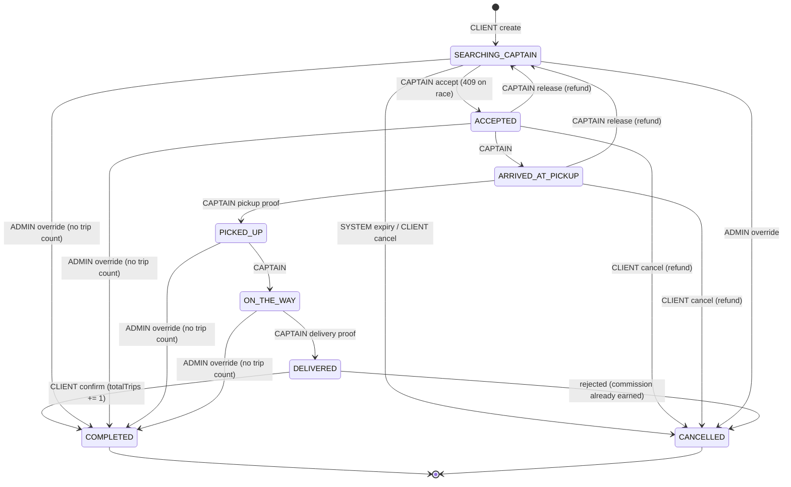

# Order flow (Phase 2)

Scope: the API under `apps/api/src/orders` and the Flutter client under
`apps/mobile/lib/screens`. All API paths below are relative to `/api/v1`.
All state changes are recorded in `OrderEvent` and visible to the order's
client, assigned captain, and admins via `GET /orders/:id/events`.

## States and actors

| Status | Meaning | Entered by |
| --- | --- | --- |
| `PENDING` | Legacy/manual entry; normal creation skips it | ADMIN / external data |
| `SEARCHING_CAPTAIN` | Order is in the captain feed | CLIENT (create), SYSTEM (release/expiry), ADMIN |
| `ACCEPTED` | Captain assigned, heading to pickup | CAPTAIN (accept), ADMIN |
| `ARRIVED_AT_PICKUP` | Captain at the collection point | CAPTAIN |
| `PICKED_UP` | Parcel collected, proof required | CAPTAIN (proof) |
| `ON_THE_WAY` | In transit to the delivery point | CAPTAIN |
| `DELIVERED` | Delivery proof stored, awaiting client confirmation | CAPTAIN (proof) |
| `COMPLETED` | Terminal; client confirmed, trip counted | CLIENT, ADMIN (forced, no trip count) |
| `CANCELLED` | Terminal; no further transition | CLIENT / SYSTEM / ADMIN |

## State diagram

The admin diagram edges are overrides, not part of the captain's normal trip
machine. `COMPLETED` and `CANCELLED` are immutable even for admins
(`admin.service.ts` terminal-state guard).

## Allowed transitions and endpoints

| From | To | Actor | Endpoint | Guard / error |
| --- | --- | --- | --- | --- |
| — | `SEARCHING_CAPTAIN` | CLIENT | `POST /orders/quote`, `POST /orders` | phone, category ack, disabled category, pricing |
| `SEARCHING_CAPTAIN` / `PENDING` | `ACCEPTED` | CAPTAIN | `POST /orders/:id/accept` | captain `ACTIVE`, phone, terms ack, sensitive ack, wallet cover; **409** if taken |
| `ACCEPTED` | `ARRIVED_AT_PICKUP` | CAPTAIN | `PATCH /orders/:id/status` | 422 for any jump outside the table |
| `ARRIVED_AT_PICKUP` | `PICKED_UP` | CAPTAIN | `POST /orders/:id/proof/pickup` | photo + one proof per type; plain PATCH returns 422 |
| `PICKED_UP` | `ON_THE_WAY` | CAPTAIN | `PATCH /orders/:id/status` | owner only |
| `ON_THE_WAY` | `DELIVERED` | CAPTAIN | `POST /orders/:id/proof/delivery` | photo + one proof per type; plain PATCH returns 422 |
| `DELIVERED` | `COMPLETED` | CLIENT | `POST /orders/:id/complete` | 422 unless exactly the owning client on `DELIVERED` |
| unassigned `SEARCHING_CAPTAIN` / `PENDING` | `CANCELLED` | CLIENT / SYSTEM | `POST /orders/:id/cancel`, expiry scheduler | no wallet movement |
| assigned `ACCEPTED` / `ARRIVED_AT_PICKUP` | `CANCELLED` | CLIENT | `POST /orders/:id/cancel` | commission refunded |
| `ACCEPTED` / `ARRIVED_AT_PICKUP` | `SEARCHING_CAPTAIN` | CAPTAIN | `POST /orders/:id/release` | commission refunded; `acceptedAt` cleared |
| `PICKED_UP` or later | `CANCELLED` | CLIENT | `POST /orders/:id/cancel` | rejected (422); admin intervention only |
| `DELIVERED` | `CANCELLED` | ADMIN | admin order override | rejected: commission already earned |
| non-terminal | any valid status / captain | ADMIN | admin order override | new captain must be `ACTIVE` and funded |

The single server-side state machine lives in `assertAllowedTransition()`
(`orders.service.ts`) and is shared by status patches and proof submissions;
`COMPLETED`-only rating is validated in `rateOrder()`.

## End-to-end happy path

1. **Quote** — CLIENT picks pickup/delivery on the map; Flutter sends
   `POST /orders/quote` with the four coordinates. API computes rounded
   distance, `price`, and `commission` from `PricingSettings`.
2. **Review / create** — `/order-review` carries the quote in the query string
   (with legacy `extra` support for in-app navigation). `POST /orders` stores
   `commission`, emits an `ORDER_CREATED` event and an in-app notification to
   the client; status becomes `SEARCHING_CAPTAIN`.
3. **Feed** — CAPTAIN's availability screen polls `GET /orders/available`
   every 5 s and posts `POST /captains/location` every 20 s. Skips are
   per-captain and permanent for an order.
4. **Accept** — `POST /orders/:id/accept` runs in one transaction: checks,
   wallet debit, atomic `updateMany` claim, ledger row, event. A second accept
   (or a concurrent one) gets **409** and no wallet movement.
5. **Trip** — CAPTAIN lands on `/captain/trip/:id`. Actions: arrival → pickup
   proof → start delivery → delivery proof. The screen polls order/events/
   proofs every 10 s and posts `POST /orders/:id/location` every 20 s during
   `ACCEPTED | ARRIVED_AT_PICKUP | PICKED_UP | ON_THE_WAY`. Maps directions and
   `tel:` buttons are only offered after acceptance.
6. **Client tracking** — `/track/:id` polls `GET /orders/:id` and
   `GET /orders/:id/location` every 15 s and draws the captain's last server
   position on the live map.
7. **Completion** — CLIENT taps "تأكيد الاستلام" → `POST /orders/:id/complete`
   (`DELIVERED → COMPLETED`). Both sides receive in-app notifications. The
   client can then rate the captain once (`POST /orders/:id/rating`, 1–5,
   optional comment; duplicate → 409).
8. **Relaunch** — a saved session restores through `goToRelaunchRoute()`:
   captain to documents / active trip / approval panel, client to an unfinished
   order's `/track/:id`, otherwise home.

## Money and `totalTrips` — exact timing

| Moment | Operation | Transaction |
| --- | --- | --- |
| `POST /orders` | `commission = price × commissionPercent / 100` is **stored** on the order | yes |
| `POST /orders/:id/accept` | captain wallet debited by `commission`; gate uses `max(commission, minimumWalletBalance)`; `ORDER_COMMISSION` negative ledger row written after the atomic claim | yes; rolled back on 409 |
| client cancel / captain release before `PICKED_UP` | wallet credited by `commission`; one `COMMISSION_REFUND` row | yes; refund happens at most once |
| `DELIVERED → COMPLETED` by CLIENT | commission becomes company revenue: **no wallet update and no ledger row**; `captainProfile.totalTrips += 1` | yes |
| admin-forced `COMPLETED` | timestamps/events only; **no** `totalTrips` increment | yes |
| any order status | no client/admin wallet is credited from an order commission | — |

Proof photos and invoices are stored on disk before their DB transaction; a
failed transaction can leave an orphan file but never an inconsistent row.

## Cancellation / commission policy

- Before pickup: client cancel refunds the reserved commission to the captain;
  captain release returns the order to `SEARCHING_CAPTAIN` and refunds it too.
- After `PICKED_UP`: client cancel is refused (422). After `DELIVERED`, even an
  admin cancel is refused — the commission is treated as earned.
- Search expiry (`ORDER_SEARCH_EXPIRY_MINUTES`) cancels only unassigned
  `PENDING`/`SEARCHING_CAPTAIN` orders, with a system event and client notice.
- Admin reassignment debits the new captain and refunds the previous holder in
  the same transaction; terminal orders cannot be reopened.

## Notifications

In-app rows are created for order creation (client), acceptance (client +
captain), every captain status update (client), client completion (captain),
cancellation/release/expiry (affected side), and admin captain-review decisions
(metadata `{screen: 'CAPTAIN_REVIEW', status}` so taps open
`/captain-documents`). Location/rating endpoints do not create notifications.
FCM push delivery is **not** part of this phase.

## Tests

- API: `orders.service.spec.ts`, `order-flow-phase2.spec.ts` — state-machine
  guards, 409 on second accept without a second debit, location authorization,
  rating rules, refund on cancel, `totalTrips` timing and notifications.
- Flutter: `order_flow_phase2_test.dart` (relaunch and URL helpers),
  `captain_trip_screen_test.dart` (heartbeat, directions, `tel:`),
  `tracking_screen_test.dart` (live marker, rating), plus Phase 1 navigation
  tests.
- Not covered here: FCM delivery, real Google Maps app launch on a device,
  concurrent DB transactions against a live Postgres instance, and every admin
  override combination.
